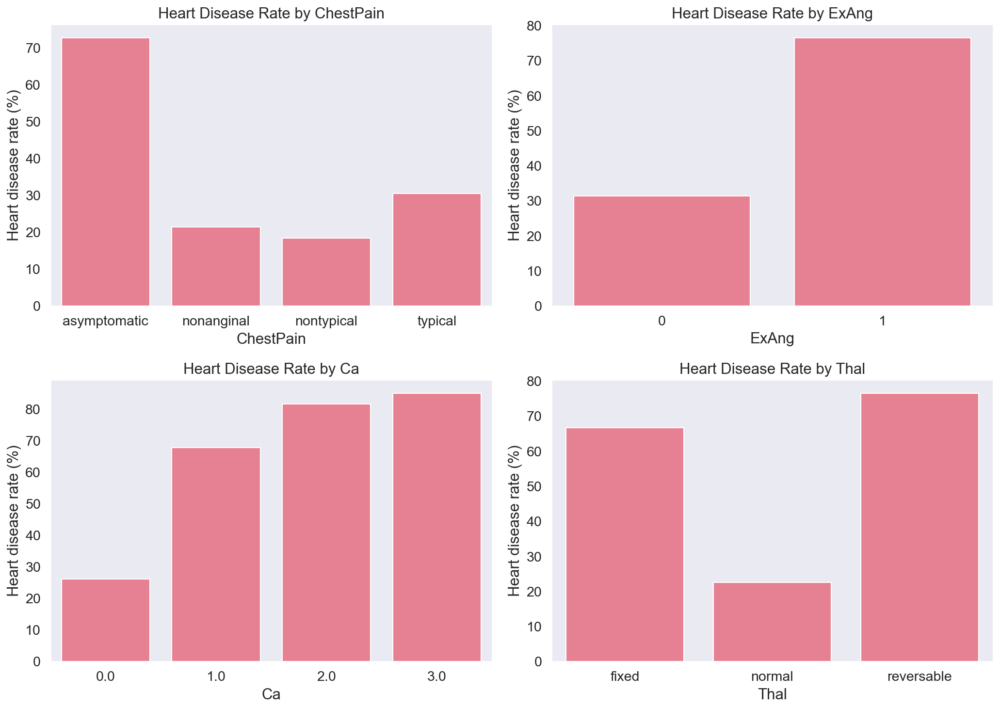
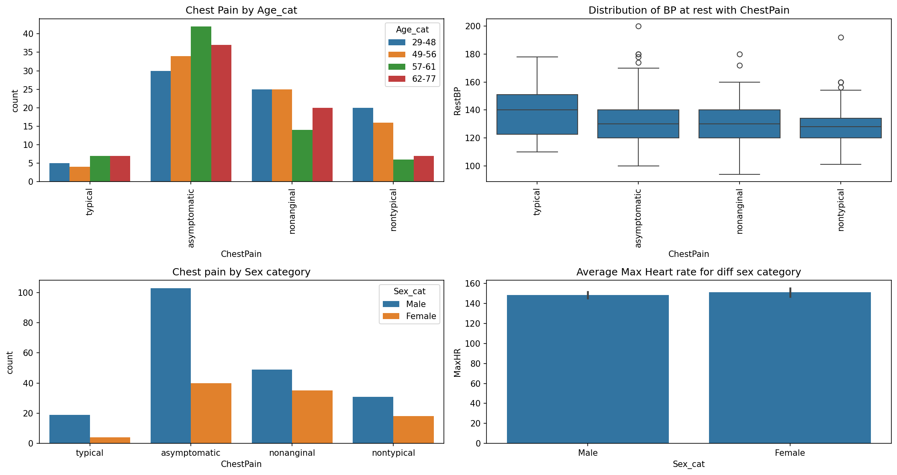
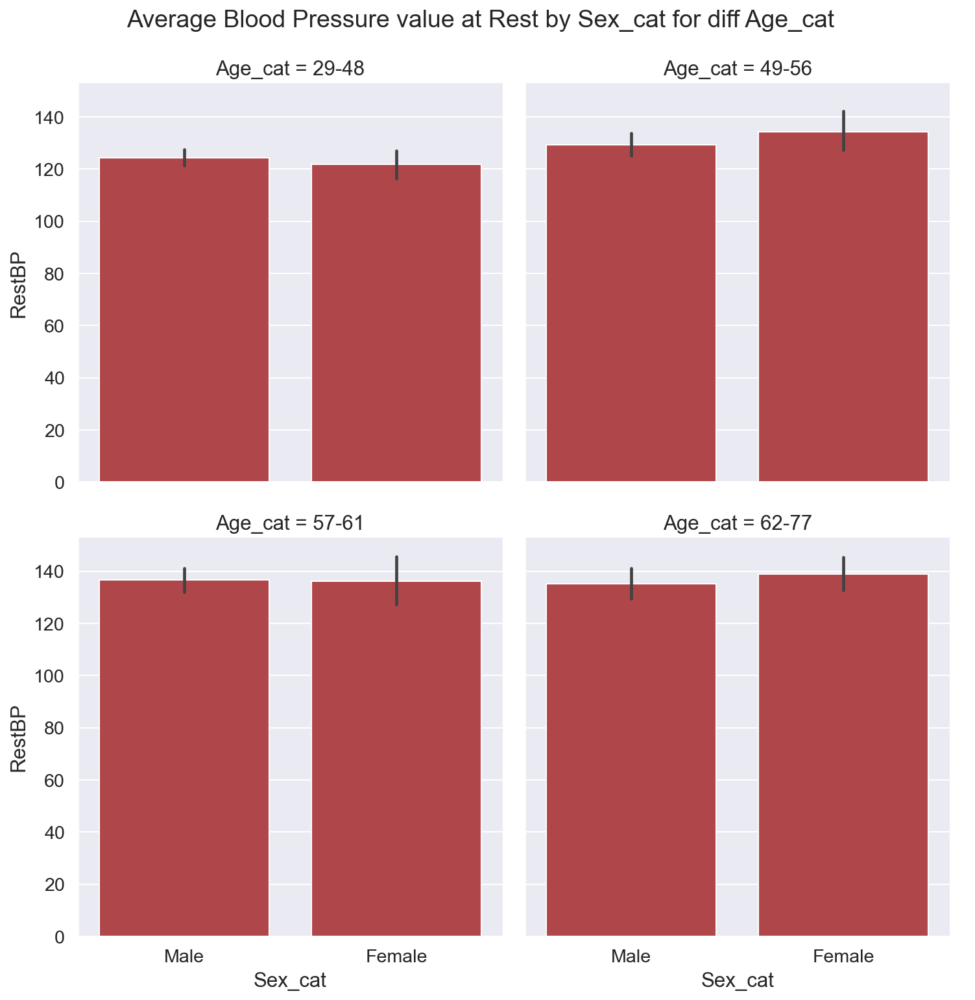
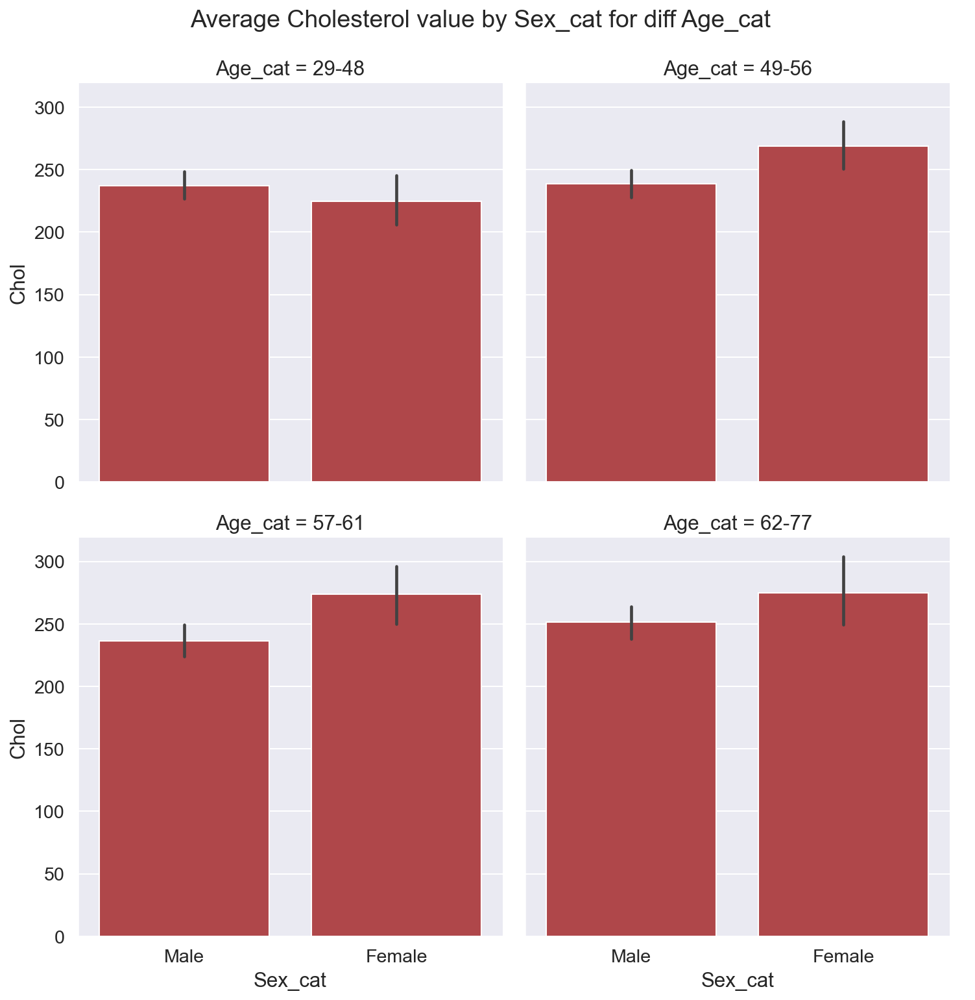

# 🫀 Heart Disease Exploratory Data Analysis (Python Project)

## 📌 Project Overview

This project uses Python to explore heart health data from 299 patients who were evaluated for heart disease. The dataset includes age, sex, chest pain type, resting blood pressure, cholesterol, fasting blood sugar, ECG results, maximum heart rate, exercise-induced angina, ST depression, the number of blocked major vessels, thallium stress test results, and whether the patient had angiographic heart disease (AHD).

About **46% of patients (138 of 299) had heart disease**.

The project followed a full EDA workflow: cleaning the data, creating age and sex categories, visualizing distributions and relationships, and transforming and scaling numeric variables. It then went a step further by comparing **heart disease rates across each risk factor** and running clinical checks, including a measure of whether each patient reached an adequate heart rate during stress testing. The main finding: **exercise-related findings and imaging results separated patients with and without heart disease far better than cholesterol or blood pressure did.**

## 🎯 Key Features

✅ Data Cleaning: Checked data types, missing values, and duplicates, and removed 4 patients with no vessel count recorded. 
✅ Feature Engineering: Created age categories and labeled sex and exercise-induced angina for clearer charts. 
✅ Exploratory Visualization: Compared chest pain, blood pressure, cholesterol, and heart rate across age and sex groups. 
✅ Distribution Analysis: Plotted the shape of each numeric variable with density curves. 
✅ Transformation and Scaling: Applied a log transform to reduce skew and standardized variables with `StandardScaler`. 
✅ Outcome Analysis: Compared heart disease rates across chest pain type, sex, exercise angina, blocked vessels, and thallium results. 
✅ Group Comparison: Compared average measurements for patients with and without heart disease. 
✅ Clinical Check: Calculated the percent of age-predicted maximum heart rate each patient reached and flagged extreme values.

## 📷 Visualizations

### Heart Disease Rate by Risk Factor

### Chest Pain Overview

### Resting Blood Pressure by Sex and Age Group

### Cholesterol by Sex and Age Group

## 🗂️ Repository Files

| File | Description |
|------|-------------|
| `Hearts.csv` | Raw dataset: 303 rows and 15 columns of patient heart data |
| `heart_disease_eda.ipynb` | Jupyter Notebook with the full code, analysis, and outputs |
| `heart_disease_rate_by_risk_factor.png` | Heart disease rates across four key risk factors |
| `chest_pain_overview.png` | Four-panel overview of chest pain, blood pressure, and heart rate |
| `restbp_by_sex_age.png` | Average resting blood pressure by sex and age group |
| `cholesterol_by_sex_age.png` | Average cholesterol by sex and age group |

## 🧹 Data Preparation

- Loaded the data with `pd.read_csv()` using a relative file path, so the notebook runs from any computer.
- Found missing values in two columns: `Ca` (number of major vessels, 4 missing) and `Thal` (thallium result, 2 missing).
- Removed the 4 patients with no vessel count, leaving **299 patients**. The 2 missing `Thal` values were kept and noted.
- Confirmed there are no duplicate rows.
- Grouped age into four categories using the 25th, 50th, and 75th percentiles (48, 56, and 61 years).
- Created readable labels for sex and exercise-induced angina.
- Dropped the unnamed row-number column.
- Applied a log transform to `Age`, `RestBP`, `Chol`, and `MaxHR` to reduce skew.
- Standardized 11 numeric columns with `StandardScaler`, giving each a mean of 0 and a variance of 1.

## 🛠️ Skills & Tools Applied

- Language and Environment: Python, Jupyter Notebook (Anaconda)
- Libraries: pandas, NumPy, Matplotlib, Seaborn, scikit-learn
- EDA Techniques: Summary statistics, missing value review, binning, group comparisons, variance checks
- Visualization: Count plots, box plots, bar plots, scatter plots, density curves, pie charts
- Data Transformation: Log transform, standardization, one-hot encoding
- Clinical Knowledge: Chest pain classification, stress test interpretation, age-predicted maximum heart rate

## 📈 Business Questions Answered

This project provides insights into:

- What does the patient population look like by age, sex, and chest pain type?
- Which clinical findings are most linked to heart disease?
- Do patients with heart disease differ in blood pressure, cholesterol, or heart rate?
- How do blood pressure and cholesterol vary across age and sex?
- Are there clinically extreme values in the data?

## 💡 Key Insights

### Patient Profile

- The dataset has **299 patients**, aged 29 to 77, with an average age of **54.5**.
- **Men made up 67.6%** of patients (202 of 299).
- **138 patients (46.2%)** had heart disease.
- The most common chest pain type was **asymptomatic** (143 patients).

### Heart Disease Rate by Risk Factor

| Risk Factor | Group | Heart Disease Rate | Patients |
|---|---|---|---|
| Chest pain | Asymptomatic | **72.7%** | 143 |
| | Typical angina | 30.4% | 23 |
| | Non-anginal | 21.4% | 84 |
| | Atypical | 18.4% | 49 |
| Exercise-induced angina | Yes | **76.5%** | 98 |
| | No | 31.3% | 201 |
| Blocked major vessels | 0 | 26.1% | 176 |
| | 1 | 67.7% | 65 |
| | 2 | 81.6% | 38 |
| | 3 | **85.0%** | 20 |
| Thallium result | Reversible defect | **76.5%** | 115 |
| | Fixed defect | 66.7% | 18 |
| | Normal | 22.6% | 164 |
| Sex | Male | 55.9% | 202 |
| | Female | 25.8% | 97 |

- **Asymptomatic patients had the highest heart disease rate (72.7%)**, more than double the rate for typical angina (30.4%). This seems backward, but it reflects how these patients were selected: they were referred for angiography, and silent ischemia is common, especially in older patients and people with diabetes.
- **Each additional blocked vessel raised the heart disease rate**, from 26.1% with none to 85.0% with three.
- **Exercise-induced angina** and a **reversible thallium defect** were each linked to a 76.5% heart disease rate.
- **Men had more than twice the rate of women** (55.9% vs. 25.8%).
- **Fasting blood sugar over 120 made almost no difference** (47.7% vs. 45.9%).

### Patients With vs. Without Heart Disease

| Measure | No Heart Disease | Heart Disease |
|---|---|---|
| Age | 52.6 | 56.7 |
| Resting BP (mmHg) | 129.2 | 134.6 |
| Cholesterol (mg/dL) | 243.3 | 251.5 |
| Max heart rate (bpm) | **158.3** | **139.2** |
| ST depression (Oldpeak) | **0.6** | **1.6** |

- **Patients with heart disease reached a lower maximum heart rate** (139 vs. 158 bpm) and had **more ST depression** during exercise (1.6 vs. 0.6).
- **Cholesterol and blood pressure barely differed** between the two groups. In this sample, exercise test findings separated the groups far better than these common risk factors.

### Clinical Checks

- **Age-predicted maximum heart rate:** patients who **did not reach 85%** of their age-predicted maximum (220 minus age) had a **71.4%** heart disease rate (91 patients), compared with **35.1%** for those who did (208 patients). Reaching 85% is the standard target for an adequate stress test.
- **Extreme values:** 4 patients had cholesterol of 400 mg/dL or higher (the highest was **564**), 5 had resting blood pressure of 180 mmHg or higher, and 8 had a maximum heart rate under 100 bpm. These values are rare but clinically possible, so they were kept.
- **Cholesterol and resting blood pressure were only weakly related** across all age groups.

*Note: This is a small, older dataset (collected in 1988) from patients referred for heart testing, and it is mostly male. The findings show patterns in this group, not in the general population. The 4 removed patients and 2 missing thallium values are documented above. This project is for learning purposes and is not medical advice.*

## 🚀 Learning Outcomes

Building this project strengthened my skills in:

📌 Loading and cleaning real-world healthcare data 
📌 Key EDA techniques using pandas and NumPy 
📌 Data visualization with Matplotlib and Seaborn 
📌 Identifying trends, distributions, and correlations in patient heart health 
📌 Understanding key health metrics that affect cardiovascular health 
📌 Comparing outcome rates across groups instead of raw counts 
📌 Applying clinical reasoning to interpret unexpected patterns

## 🔮 Next Steps

- Build a classification model to predict heart disease and compare it with a simple clinical rule.
- Add statistical tests, such as chi-square and t-tests, to confirm which differences are significant.
- Use the percent of age-predicted maximum heart rate as a model feature.
- Compare these results with a larger, more recent heart disease dataset.

## 📚 Dataset Source

[Heart Disease Dataset](https://www.kaggle.com/YOUR-DATASET-LINK) on Kaggle, based on the Cleveland Heart Disease data from the UCI Machine Learning Repository.

## 🙌 Acknowledgment

This project taught me that the most useful EDA question is not "what does the data look like?" but "what separates patients who have the disease from those who don't?" Comparing outcome rates, and using clinical knowledge to explain surprising results like asymptomatic chest pain, turned a set of charts into real insight.

## 🔗 Related Link

[LinkedIn Post](https://www.linkedin.com/feed/update/urn:li:activity:7528750433679446016/)

## 👨‍💻 Author

**Omar Shazley**: Data Analyst | Python, Excel, SQL, and healthcare data analytics

💼 [LinkedIn](https://www.linkedin.com/in/omar-shazley-914a16b1/) 
💻 [GitHub Portfolio](https://github.com/Bromar95) 
📧 Email: [omarshazley@gmail.com](mailto:omarshazley@gmail.com)

✨ If you like this project, don't forget to ⭐ star the repo!
